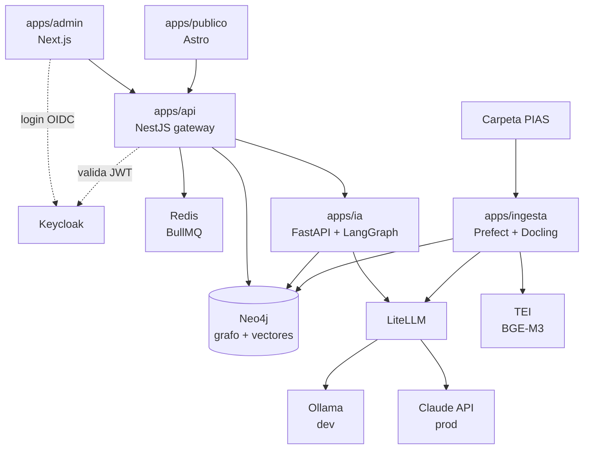
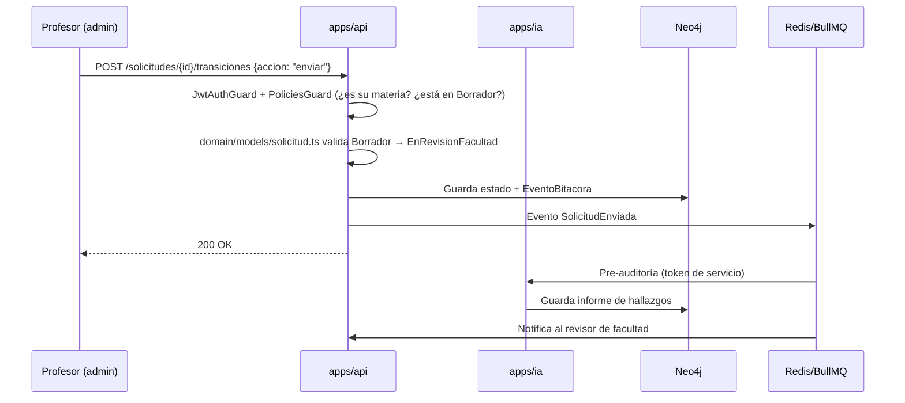

# Arquitectura de la Plataforma PIAs

Guía para entender cómo está construida la plataforma: qué hace cada servicio, por qué se eligió cada tecnología, cómo se comunican las piezas, qué va (y qué no va) en cada carpeta, y cómo se trabaja en cada área.

> La fuente de la verdad es [`documento-de-la-verdad.md`](documento-de-la-verdad.md). Si esta guía y el documento difieren, gana el documento. Cualquier cambio de arquitectura se propone primero ahí.

Diagramas interactivos (abrir en el navegador):

- [`diagramas/arquitectura.html`](diagramas/arquitectura.html) — componentes y conexiones.
- [`diagramas/flujo-aprobacion.html`](diagramas/flujo-aprobacion.html) — flujo de aprobación de un PIA.

---

## 1. Visión general

La plataforma resuelve un problema concreto: los ~45.000 PIAs de la universidad se desactualizan y nadie valida que lo que se enseña coincide con el programa aprobado. Para eso, la plataforma:

1. Convierte cada cambio de un PIA en un **trámite con doble aprobación** (facultad y consejo académico).
2. **Audita los PIAs con IA** (secciones faltantes, antipatrones, incumplimiento de normativa).
3. Permite **consultas en lenguaje natural** para administrativos.
4. Publica un **portal público** para prospectos de estudiante.

La arquitectura es **mixta**: cada capa usa el estilo que mejor le sirve.

| Capa                            | Estilo                            | Por qué                                                                                 |
| ------------------------------- | --------------------------------- | --------------------------------------------------------------------------------------- |
| Backend (`apps/api`)            | Hexagonal (puertos y adaptadores) | Las reglas del flujo de aprobación deben poder probarse sin base de datos ni framework. |
| Ingesta (`apps/ingesta`)        | Pipeline orientado a eventos      | 45.000 archivos: el proceso debe poder reanudarse si falla a mitad.                     |
| IA (`apps/ia`)                  | Agéntico (supervisor + agentes)   | Cada tipo de pregunta necesita herramientas y permisos distintos.                       |
| Portal público (`apps/publico`) | Islas + generación estática       | Páginas rápidas, buen SEO y casi nada de JavaScript.                                    |



**Regla de oro:** los frontends solo hablan con el gateway (`apps/api`). Nunca con Neo4j ni con el servicio de IA.

---

## 2. Estructura de carpetas

```
pias-plataforma/
├── apps/
│   ├── admin/        # Next.js: paneles de profesor, facultad, consejo y administrativos
│   ├── publico/      # Astro: portal para prospectos
│   ├── api/          # NestJS: gateway (auth, permisos, flujo, API REST)
│   ├── ia/           # FastAPI + LangGraph: agentes, auditoría, chat
│   └── ingesta/      # Prefect + Docling: carga y procesamiento de PIAs
├── packages/
│   ├── api-client/   # Cliente TypeScript tipado, generado del contrato OpenAPI
│   ├── permisos/     # Reglas CASL compartidas entre front y back
│   ├── ui/           # shadcn/ui + Tailwind compartidos (src/components/ui/, §4.1)
│   └── config-ts/    # tsconfig base
├── contracts/        # openapi.yaml: contrato de la API (fuente del cliente y los tipos)
├── specs/            # Especificaciones: constitución + una carpeta por feature
├── infra/            # Docker Compose, realm de Keycloak, migraciones Neo4j, seeds
├── docs/             # Documento de la verdad, esta guía, diagramas, instalación
├── scripts/          # install.sh, run.sh, dev-menu.sh (arranque del entorno)
└── .github/          # CI y plantilla de pull request
```

### 2.1 Qué va y qué NO va en cada carpeta

| Carpeta               | Qué va                                                                                                         | Qué NO va                                                                                                                         |
| --------------------- | -------------------------------------------------------------------------------------------------------------- | --------------------------------------------------------------------------------------------------------------------------------- |
| `apps/admin`          | Pantallas, componentes de cliente, hooks, llamadas al gateway con `@pias/api-client`                           | Reglas de negocio del flujo, consultas Cypher, llamadas a `apps/ia`, lógica de seguridad real (solo se ocultan botones)           |
| `apps/publico`        | Páginas estáticas de facultades, carreras y materias; islas React (chat, comparador)                           | Login, datos de borradores, hallazgos, comentarios; cualquier dato que no sea de una versión `Vigente` marcada como pública       |
| `apps/api`            | Autenticación, permisos, máquina de estados, bitácora, endpoints REST y SSE, colas                             | Llamadas directas a modelos de IA, parseo de documentos, prompts                                                                  |
| `apps/ia`             | Agentes, herramientas Cypher de lectura, búsqueda híbrida, auditoría, prompts                                  | Cambios de estado de solicitudes, gestión de usuarios, decisiones de permisos tomadas por el LLM, nombres de modelos en el código |
| `apps/ingesta`        | Parseo, OCR, extracción a JSON, chunking, embeddings, detección de duplicados                                  | Endpoints para usuarios, lógica de aprobación, escritura de versiones que no sean la carga inicial `origen = migracion`           |
| `packages/api-client` | Código **generado** desde `contracts/openapi.yaml` y el wrapper `crearCliente`                                 | Tipos escritos a mano que dupliquen el contrato                                                                                   |
| `packages/permisos`   | Definición de habilidades CASL por rol y alcance                                                               | Consultas a base de datos, lógica de UI                                                                                           |
| `packages/ui`         | Componentes visuales reutilizables y accesibles                                                                | Llamadas a la API, estado de negocio                                                                                              |
| `contracts`           | `openapi.yaml`                                                                                                 | Implementación                                                                                                                    |
| `specs`               | `constitution/` y `features/NNN-modulo-nombre/{spec,plan,tasks}.md`                                            | Código                                                                                                                            |
| `infra`               | `docker-compose*.yml`, `keycloak/pias-realm.json`, `neo4j/migraciones/NNN_*.cypher`, scripts de seed y modelos | Secretos reales, datos privados de PIAs (`infra/muestra/privado/` está en `.gitignore`)                                           |
| `docs`                | Documentación de proyecto y diagramas                                                                          | Specs de features (van en `specs/`)                                                                                               |

---

## 3. Servicios: función, framework y por qué

Cada servicio se describe igual: **qué hace**, **por qué ese framework**, **qué rol cumple**, **qué fallaría sin él**, **alcance** y **qué no debe hacer**.

### 3.1 `apps/api` — Gateway (NestJS)

- **Qué hace:** es la única puerta de entrada al sistema. Valida tokens de Keycloak, aplica roles y permisos, gestiona el flujo de aprobación, guarda versiones y bitácora en Neo4j, publica eventos en colas y hace de proxy SSE hacia el servicio de IA.
- **Por qué NestJS:** trae de serie inyección de dependencias, módulos, guards, interceptores y `@nestjs/swagger`. Eso encaja directamente con la arquitectura hexagonal (puertos inyectables, adaptadores intercambiables) y con aplicar permisos de forma declarativa (`@CheckPolicies`). Es TypeScript, así que comparte tipos y reglas CASL con el frontend.
- **Rol en el proyecto:** dueño del negocio. Es el único que puede cambiar el estado de una solicitud o crear una versión vigente.
- **Sin él:** cada frontend tendría que aplicar la seguridad por su cuenta (inseguro), las transiciones inválidas podrían llegar a la base de datos y no habría bitácora confiable. El trámite perdería su valor legal e institucional.
- **Estructura interna:**
  - `domain/` — entidades, eventos y la máquina de estados (`solicitud.ts`). TypeScript puro, sin NestJS ni Neo4j, 100 % testeable.
  - `ports/` — interfaces (`PiaRepository`, `IaClient`, `Notificador`).
  - `adapters/` — implementaciones concretas (Neo4j, HTTP al servicio IA, correo).
  - `modules/` — `auth`, `usuarios`, `pias`, `solicitudes`, `comentarios`, `notificaciones`, `chat`, `publico`.
- **Alcance:** usuarios, permisos, solicitudes, versiones, comentarios, notificaciones, endpoints públicos de solo lectura.
- **No debe:** llamar a modelos de IA directamente, construir Cypher concatenando texto, ni dejar que `domain/` importe frameworks.

### 3.2 `apps/ia` — Servicio de IA (FastAPI + LangGraph)

- **Qué hace:** responde el chat interno y público, hace la pre-auditoría de cada solicitud y audita PIAs completos. Usa búsqueda híbrida (vectores + grafo) sobre Neo4j.
- **Por qué FastAPI:** el ecosistema de IA (LangGraph, neo4j-graphrag, LiteLLM, Instructor, Docling) vive en Python. FastAPI es asíncrono, soporta streaming y genera OpenAPI y validación con Pydantic automáticamente.
- **Por qué LangGraph:** permite modelar un **supervisor** que enruta cada pregunta al agente correcto (`analista`, `buscador`, `auditor`, `guia`) como un grafo de estados explícito y trazable, en lugar de una cadena de prompts opaca.
- **Por qué LiteLLM:** una sola interfaz para Ollama (desarrollo) y Claude (producción). El código pide una **tarea** (`extraccion`, `clasificacion`, `chat_publico`, `auditoria`) y `config/modelos.yaml` decide el modelo por entorno. Cambiar de modelo es cambiar configuración, no código.
- **Por qué Instructor + Pydantic:** toda salida del LLM que se guarda (secciones, hallazgos) se valida contra un esquema. Sin esto se guardarían datos mal formados.
- **Rol en el proyecto:** dueño de todo lo que usa modelos.
- **Sin él:** no habría auditoría automática, ni chat, ni pre-auditoría en el envío; la facultad revisaría a ciegas.
- **Alcance:** lectura del grafo filtrada por el alcance del usuario que le pasa el gateway.
- **No debe:** ser accesible desde internet (solo el gateway lo llama, con token de servicio), cambiar estados de solicitudes, decidir permisos con el LLM, ni exponer hallazgos o borradores al agente público `guia`.

### 3.3 `apps/ingesta` — Pipeline de ingesta (Prefect + Docling)

- **Qué hace:** recorre la carpeta `PIAS/AÑO/MES/SEMANA/CODIGO` (PDF, DOCX, PNG, JPG) y la convierte en nodos del grafo:
  archivo → parseo con layout (Docling / OCR con Surya) → extracción a JSON por secciones (LLM + Instructor) → normalización de secciones → chunk por sección (Chonkie solo si pasa de ~512 tokens) → encabezado `Facultad > Carrera > Materia > Sección` → embeddings BGE-M3 → Neo4j.
- **Por qué Prefect:** orquesta cada etapa como un paso independiente, con reintentos, backoff y reanudación. Procesar 45.000 archivos sin esto significaría volver a empezar desde cero ante cualquier fallo.
- **Por qué Docling + Surya:** los PIAs tienen tablas, dos columnas y escaneos. Un extractor de texto plano rompería la estructura; Docling conserva el layout y Surya hace OCR de imágenes guardando la confianza.
- **Por qué chunking estructural:** cortar por tamaño fijo parte secciones y mezcla objetivos con bibliografía, lo que arruina la búsqueda y la auditoría.
- **Por qué BGE-M3 (vía TEI):** multilingüe, rinde bien en español, 1024 dimensiones, corre en CPU en desarrollo. Es el mismo modelo en todos los entornos porque cambiarlo obliga a reindexar todo.
- **Rol en el proyecto:** llena y mantiene la base de conocimiento.
- **Sin él:** el grafo estaría vacío; ni el chat, ni la auditoría, ni el portal tendrían datos.
- **Alcance:** carga inicial (`origen = migracion`) y reindexación cuando se aprueba una versión.
- **No debe:** exponer endpoints a usuarios, crear solicitudes ni aprobar versiones, ni reprocesar archivos ya procesados (debe ser idempotente: hash exacto + MinHash para duplicados).

### 3.4 `apps/admin` — Panel interno (Next.js)

- **Qué hace:** una sola app para profesores, revisores de facultad, consejo académico y administrativos. El menú y las rutas cambian según el rol.
- **Por qué Next.js:** Server Components para listados y lectura (menos JavaScript en el navegador), Client Components solo donde hace falta (editor, chat, grafo), middleware para proteger rutas por rol y Auth.js para OIDC con Keycloak.
- **Organización:** Feature-Sliced Design (`app/`, `features/`, `entities/`, `shared/`).
- **Herramientas clave:** TanStack Query (caché e invalidación tras cada transición), TanStack Table (buscador de PIAs), Sigma.js (explorador del grafo), AI SDK `useChat` (chat con streaming), shadcn/ui (accesibilidad AA).
- **Rol en el proyecto:** donde ocurre el trámite: editar por secciones, ver el diff, aprobar o devolver, auditar.
- **Sin él:** el flujo de aprobación no tendría interfaz; todo se haría por fuera del sistema, como hoy.
- **No debe:** contener lógica de seguridad real (solo oculta botones con `@pias/permisos`), guardar tokens en `localStorage`, ni llamar a Neo4j o a `apps/ia`.

> Next.js 16 trae cambios incompatibles con versiones anteriores. Leer `apps/admin/AGENTS.md` antes de escribir código.

### 3.5 `apps/publico` — Portal público (Astro)

- **Qué hace:** páginas de facultades, carreras y materias en lenguaje sencillo, y un chat para prospectos.
- **Por qué Astro:** genera HTML estático (SSG) y solo hidrata las islas interactivas (`client:visible`). Resultado: páginas muy rápidas y buen SEO, que es lo que necesita un portal de captación.
- **Rol en el proyecto:** cara pública de la información aprobada.
- **Sin él:** los prospectos seguirían sin acceso a programas actualizados y comprensibles.
- **No debe:** tener login, mostrar hallazgos, borradores o comentarios, ni consumir algo que no sea `/api/v1/publico/*`.

### 3.6 Neo4j — Base de datos única

- **Qué hace:** guarda la estructura académica (facultad → carrera → materia), los PIAs y sus versiones, las solicitudes y la bitácora, los hallazgos de la IA y los vectores de los fragmentos.
- **Por qué Neo4j:** las preguntas del proyecto son de relaciones ("PIAs de la facultad X con el antipatrón Y", "cadena de versiones de un PIA"). Un grafo las responde con una consulta directa. Además tiene índices vectoriales y de texto, así que no hace falta una segunda base de datos vectorial que mantener sincronizada.
- **Sin él:** habría que mantener una base relacional más una vectorial, y sincronizarlas en cada aprobación.
- **Reglas:** Cypher siempre parametrizado (`$facultad`), el alcance del usuario como filtro en la consulta, migraciones versionadas en `infra/neo4j/migraciones/`.

### 3.7 Keycloak — Identidad

- **Qué hace:** login OIDC de los usuarios internos (federable con el directorio de la universidad) y tokens de servicio entre gateway e IA.
- **Por qué Keycloak:** estándar abierto, autoalojable, soporta LDAP/AD y roles. El gateway nunca guarda contraseñas; solo valida firmas.
- **Sin él:** habría que construir autenticación propia, con todos sus riesgos.

### 3.8 Redis + BullMQ — Colas

- **Qué hace:** ejecuta efectos secundarios de los eventos de dominio: notificaciones, escritura de bitácora, reindexación, alertas por plazos vencidos (15 días hábiles por etapa).
- **Por qué:** esos efectos no deben bloquear la respuesta al usuario ni perderse si un servicio está caído; la cola los reintenta.

### 3.9 Ollama, TEI, Langfuse — Soporte de IA

- **Ollama:** modelos Qwen locales en desarrollo, sin coste ni envío de datos a terceros.
- **TEI (Text Embeddings Inference):** sirve BGE-M3 y el reranker `bge-reranker-v2-m3`.
- **Langfuse:** traza cada llamada a un modelo (tarea, modelo, latencia) y guarda los resultados del set de evaluación. Sin él no hay forma de saber si un cambio de modelo o de chunking empeoró las respuestas.

---

## 4. Cómo se comunican los servicios

| Origen                    | Destino                   | Protocolo                      | Autenticación                                                    | Para qué                                                |
| ------------------------- | ------------------------- | ------------------------------ | ---------------------------------------------------------------- | ------------------------------------------------------- |
| `apps/admin`              | Keycloak                  | OIDC Authorization Code + PKCE | —                                                                | Login; sesión en cookie `httpOnly`                      |
| `apps/admin`              | `apps/api`                | REST `/api/v1/*` + SSE (chat)  | `Authorization: Bearer <JWT>`                                    | Toda la operación interna                               |
| `apps/publico`            | `apps/api`                | REST `/api/v1/publico/*` + SSE | Ninguna; límite por IP                                           | Build estático y chat de prospectos                     |
| `apps/api`                | Keycloak                  | JWKS (en caché)                | —                                                                | Validar firma, emisor, audiencia y expiración del token |
| `apps/api`                | Neo4j                     | Bolt (`neo4j-driver`)          | Usuario de servicio                                              | Leer y escribir PIAs, versiones, solicitudes, bitácora  |
| `apps/api`                | Redis                     | BullMQ                         | —                                                                | Publicar eventos de dominio                             |
| `apps/api`                | `apps/ia`                 | HTTP interno + SSE             | Token client credentials de Keycloak + rol y alcance del usuario | Chat, pre-auditoría, reindexación                       |
| `apps/ia`                 | Neo4j                     | Bolt                           | Usuario de solo lectura (salvo hallazgos)                        | Búsqueda híbrida, herramientas Cypher                   |
| `apps/ia`, `apps/ingesta` | LiteLLM → Ollama / Claude | HTTP                           | API key en prod                                                  | Llamadas a modelos por tarea                            |
| `apps/ingesta`            | TEI                       | HTTP                           | —                                                                | Embeddings                                              |
| `apps/ingesta`            | Neo4j                     | Bolt                           | Usuario de servicio                                              | Escribir PIAs, secciones, fragmentos                    |

### Ejemplo: un profesor envía una actualización



El envío no espera a la IA: la pre-auditoría informa, pero no bloquea.

### El contrato como pegamento

`contracts/openapi.yaml` es el acuerdo entre front y back. De él se generan los tipos TypeScript (`packages/api-client`) y los modelos Pydantic. Si el contrato cambia y un frontend no se actualiza, **falla la compilación, no producción**.

```bash
pnpm turbo run generate:api
```

---

## 5. Herramientas del proyecto

| Área     | Herramienta                    | Para qué                                                                                |
| -------- | ------------------------------ | --------------------------------------------------------------------------------------- |
| Monorepo | pnpm workspaces                | Dependencias TypeScript compartidas                                                     |
| Monorepo | Turborepo                      | Ejecuta `dev`, `build`, `lint`, `test` en todas las apps con caché                      |
| Python   | uv                             | Entornos y dependencias de `apps/ia` y `apps/ingesta`                                   |
| Calidad  | Prettier, ESLint, oxlint, ruff | Formato y lint (TS y Python)                                                            |
| Calidad  | lefthook + commitlint          | Hooks de pre-commit y Conventional Commits                                              |
| Pruebas  | Vitest, Playwright             | Unitarias y end-to-end en TypeScript                                                    |
| Pruebas  | pytest, DeepEval               | Pruebas y evaluación del RAG en Python                                                  |
| Infra    | Docker Compose                 | Neo4j, Keycloak, Redis, Ollama, TEI en local, con perfiles `full`, `api`, `admin`, `ia` |
| CI       | GitHub Actions                 | `pnpm turbo run lint test build` en cada PR                                             |
| Docs     | archify                        | Diagramas en `docs/diagramas/`                                                          |

---

## 6. Flujo de trabajo

### 6.1 Flujo común a todas las áreas

Cada subproyecto tiene **tres personas trabajando a la vez**, así que el orden importa:

1. **Spec primero.** Rama `spec/NNN-modulo-nombre`, copiar `specs/features/_plantilla/`, escribir `spec.md`, `plan.md` y `tasks.md`. PR y aprobación antes de programar.
2. **Rama de feature.** `git switch main && git pull`, luego `git switch -c feat/NNN-modulo-nombre`.
3. **Pruebas desde la spec.** Cada criterio de aceptación se vuelve una prueba.
4. **Commits pequeños** con Conventional Commits: `feat(api): transición de aprobación de facultad`.
5. **Mantener la rama al día:** `git fetch origin && git rebase origin/main` con frecuencia, para no chocar con los compañeros.
6. **Antes de subir:** `pnpm lint && pnpm test`.
7. **PR** con la plantilla (enlace a la spec, qué cambió, cómo probarlo). Lo revisa alguien que no trabajó en esa área.
8. **Squash merge** a `main` solo con CI en verde y una aprobación. Borrar la rama.
9. Actualizar `tasks.md` y `specs/constitution/roadmap.md`.

Nadie hace commits directos a `main`. Las ramas viven menos de 3 días; si una tarea es más grande, se divide.

### 6.2 Particularidades por área

| Área            | Arranque                             | Antes de programar                                                     | Al terminar                                                            |
| --------------- | ------------------------------------ | ---------------------------------------------------------------------- | ---------------------------------------------------------------------- |
| `apps/api`      | `bash scripts/run.sh` (perfil `api`) | Si cambia la API, actualizar `contracts/openapi.yaml` en la spec       | Pruebas de `domain/` sin framework; `pnpm --filter @pias/api test`     |
| `apps/admin`    | Perfil `admin` + gateway             | Leer `apps/admin/AGENTS.md`; regenerar cliente si cambió el contrato   | Verificar que las acciones se ocultan según `@pias/permisos`           |
| `apps/publico`  | Solo necesita la API                 | Confirmar que los datos son públicos y vigentes                        | Revisar SEO (metadatos, sitemap, schema.org)                           |
| `apps/ia`       | Perfil `ia` + `pnpm modelos`         | Definir la tarea en `config/modelos.yaml`, nunca un modelo en código   | Correr el set de evaluación; si empeora recall@10 o MRR, no se fusiona |
| `apps/ingesta`  | Perfil `ia`                          | Probar con la muestra de `infra/muestra/`                              | Verificar idempotencia (correr dos veces no duplica)                   |
| `infra` / Neo4j | `pnpm infra:up`                      | Nueva migración `NNN_descripcion.cypher`, nunca editar una ya aplicada | `pnpm seed` sobre una base limpia                                      |

---

## 7. Resumen de límites duros

- Los frontends no llaman a Neo4j ni al servicio de IA.
- El servicio de IA no es accesible desde internet.
- El LLM nunca decide permisos; los permisos se aplican en el gateway y como filtro en Cypher.
- El código nunca nombra un modelo; usa tareas.
- Nada llega a `Vigente` sin aprobación del consejo; las versiones anteriores pasan a `Historico` y nunca se borran.
- Nadie aprueba una solicitud que creó.
- Cypher siempre parametrizado.
- Cambiar el modelo de embeddings obliga a reindexar con un índice nuevo y a pasar el set de evaluación.
- `.env*` nunca entra al repositorio.
