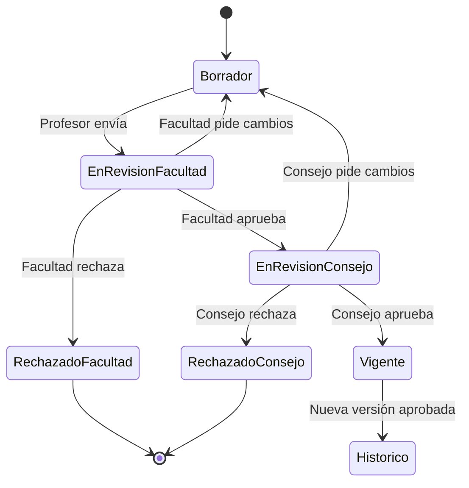
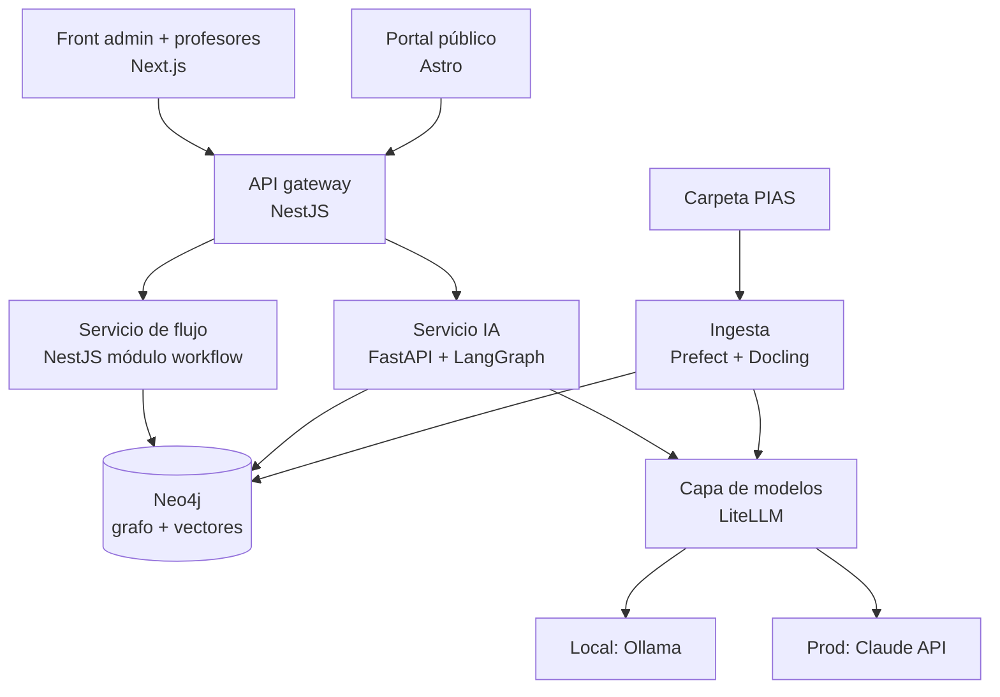
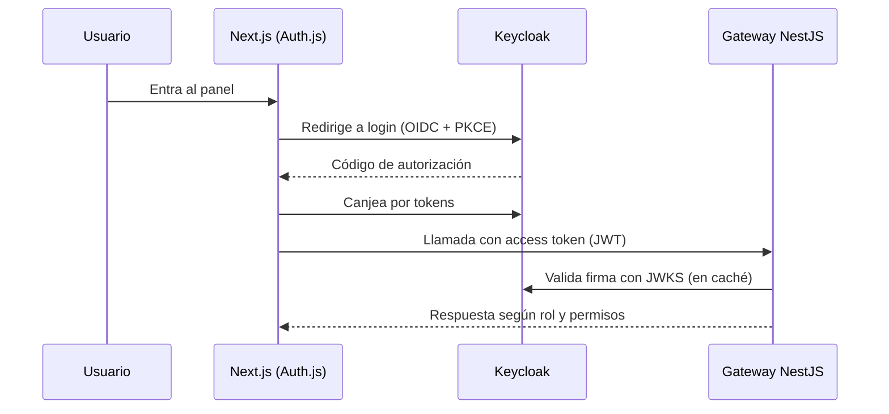
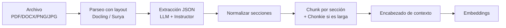
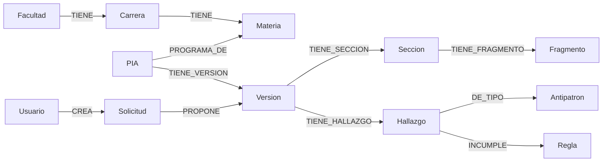
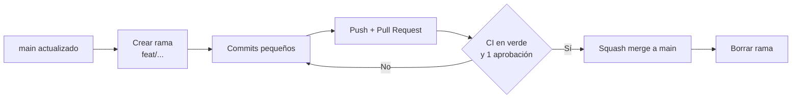

# Documento de la verdad — Plataforma de gestión de PIAs

Sep 24, 2026 · @Sebastian Garzon Arias

## 1. Contexto y problema

La universidad tiene unos 45.000 PIAs y ningún mecanismo que valide que lo que se enseña en el aula coincide con el programa aprobado. Esta plataforma convierte cada actualización de un PIA en un trámite trazable con doble aprobación, y además permite consultar, auditar y explicar los PIAs con IA.

**Situación actual.** Los PIAs viven en una carpeta con la estructura `PIAS/AÑO/MES/SEMANA/CODIGO`, en formatos PDF, DOCX, PNG y JPG. Todos comparten secciones similares: nombre de la materia, código del PIA, objetivo general, objetivos específicos, contenidos y otras secciones.

**Problema.** Los PIAs se desactualizan. Los profesores incorporan temas nuevos en clase, pero ese conocimiento no pasa por ninguna validación institucional. El resultado es que el documento oficial y la práctica real divergen, y nadie puede saber cuáles PIAs están incompletos, son ambiguos o incumplen la normativa.

**Qué resuelve la plataforma:**

- **Gestión de actualizaciones:** el profesor propone cambios, la facultad los revisa y el consejo académico da la aprobación final. Nada entra al PIA vigente sin ese recorrido.
- **Auditoría asistida por IA:** detecta antipatrones, secciones faltantes, redacción poco clara e incumplimientos de la normativa.
- **Consulta para administrativos:** preguntas como "PIAs de la facultad X con el antipatrón Y" o "los PIAs más antiguos sin actualizar".
- **Portal público:** los prospectos de estudiante exploran carreras y materias con información aprobada y en lenguaje sencillo.

**Principio rector:** este documento es la fuente de la verdad del proyecto. Cualquier decisión técnica que lo contradiga se discute primero aquí, se actualiza este documento y solo después se implementa.

## 2. Flujo de actualización y aprobación

Un cambio a un PIA pasa por tres actores en orden: profesor, facultad y consejo académico. Solo la aprobación del consejo convierte una propuesta en la nueva versión vigente.



Cada flecha es una transición permitida; cualquier otra se rechaza en el backend.

**Reglas del flujo:**

1. El profesor solo puede editar PIAs de materias que tiene asignadas, y solo en estado `Borrador`.
2. Al enviar, la IA hace una **pre-auditoría automática**: completitud, antipatrones y normativa. El resultado se adjunta a la solicitud como informe, pero no bloquea el envío.
3. La facultad ve el **diff** entre la versión vigente y la propuesta, junto con el informe de la IA. Puede aprobar, rechazar o pedir cambios con comentarios por sección.
4. El consejo académico recibe solo lo aprobado por la facultad, y puede agrupar solicitudes por sesión de consejo.
5. Al aprobarse, la versión anterior pasa a `Historico` (nunca se borra), la nueva se vuelve `Vigente` y se reindexa en Neo4j para que el chat y el portal público la usen de inmediato.
6. Toda transición queda registrada en una bitácora inmutable: quién, cuándo, desde qué estado, hacia qué estado y con qué comentario.
7. Los plazos (por ejemplo, 15 días hábiles por etapa) generan notificaciones y alertas de solicitudes estancadas.

**Carga inicial:** los 45.000 PIAs de la carpeta entran como versión `Vigente` inicial con la marca `origen = migracion`, para distinguirlos de los aprobados dentro del flujo.

## 3. Arquitectura general

El sistema es un monorepo con dos frontends, un gateway en NestJS, un servicio de IA en Python y Neo4j como base de datos única de grafo y vectores. Los modelos se usan en local durante el desarrollo y de pago en producción, y se cambian solo por configuración.



Los frontends solo hablan con el gateway; nunca con Neo4j ni con el servicio de IA directamente.

| Componente             | Responsabilidad                                                                | Lenguaje   |
| ---------------------- | ------------------------------------------------------------------------------ | ---------- |
| Front admin (Next.js)  | Paneles de profesores, facultad y consejo; auditoría; explorador del grafo     | TypeScript |
| Portal público (Astro) | Páginas de carreras y materias, chat para prospectos                           | TypeScript |
| Gateway (NestJS)       | Auth, roles, permisos, flujo de aprobación, streaming SSE                      | TypeScript |
| Servicio IA (FastAPI)  | Agentes, búsqueda híbrida, auditoría de PIAs                                   | Python     |
| Ingesta (Prefect)      | Parseo, OCR, extracción, chunking, embeddings                                  | Python     |
| Neo4j                  | Grafo de facultades, carreras, materias, PIAs, versiones, hallazgos y vectores | Cypher     |
| LiteLLM                | Interfaz única a modelos locales y de pago                                     | Python     |

**Entornos:**

- **Desarrollo:** Docker Compose con Neo4j, Ollama, Redis, Keycloak y los servicios; modelos Qwen locales.
- **Staging:** igual que producción pero con datos anonimizados; aquí se corre el set de evaluación antes de cambiar de modelo.
- **Producción:** modelos de Anthropic vía API, Neo4j administrado (Aura) o autoalojado, y el mismo modelo de embeddings que en desarrollo.

## 4. Metodología y patrones de diseño

El proyecto sigue una arquitectura mixta guiada por especificaciones (**spec-driven development**): ninguna funcionalidad se programa sin una especificación escrita y aprobada. Cada etapa del sistema usa además los patrones de diseño de la tabla de abajo.

**Ciclo de spec-driven development:**

1. **Especificar.** Se escribe `specs/<modulo>/<funcionalidad>.md` con el objetivo, los criterios de aceptación, el contrato de la API (OpenAPI) y los casos límite.
2. **Revisar.** La spec se aprueba en un pull request, antes de escribir código.
3. **Contrato primero.** Del OpenAPI se generan los tipos TypeScript y los modelos Pydantic, de modo que front y back compilan contra el mismo contrato.
4. **Pruebas desde la spec.** Cada criterio de aceptación se vuelve una prueba (Vitest/Jest en TypeScript, pytest en Python).
5. **Implementar** hasta que las pruebas pasen.
6. **Actualizar** la spec si algo cambió en el camino. La spec y el código nunca divergen.

La arquitectura es "mixta" porque combina estilos según la capa: hexagonal en el backend, event-driven en la ingesta, agéntico en la IA e islas en el portal público.

| Etapa                  | Patrones de diseño                                                                         | Para qué                                                           |
| ---------------------- | ------------------------------------------------------------------------------------------ | ------------------------------------------------------------------ |
| Backend NestJS         | Arquitectura hexagonal (puertos y adaptadores), inyección de dependencias, Repository, DTO | Aislar la lógica de negocio de Neo4j y de los proveedores externos |
| Flujo de aprobación    | State (máquina de estados), Command, Domain Events, Audit Log                              | Transiciones válidas y trazables                                   |
| Auth, roles y permisos | Guard/Interceptor, RBAC + ABAC, Policy                                                     | Reglas de acceso centralizadas y verificables                      |
| Ingesta                | Pipeline (Pipes and Filters), Event-driven, Idempotent Consumer, Retry con backoff         | Procesar 45.000 archivos de forma reanudable                       |
| Chunking               | Strategy, Template Method                                                                  | Cambiar estrategia de chunking por tipo de documento               |
| Embeddings y modelos   | Adapter, Strategy, Factory (vía LiteLLM)                                                   | Cambiar de modelo local a pago sin tocar código                    |
| Servicio IA            | Supervisor multiagente, Tool Use, Chain of Responsibility (router)                         | Enrutar cada pregunta al agente correcto                           |
| Neo4j                  | Repository, Unit of Work (transacciones), Query Object (Cypher parametrizado)              | Consultas seguras y testeables                                     |
| API                    | API Gateway, BFF (Backend for Frontend), Contract-first, CQRS ligero                       | Un contrato estable por frontend                                   |
| Front Next.js          | Feature-Sliced Design, Server Components, Container/Presentational, custom hooks           | Código organizado por funcionalidad                                |
| Portal Astro           | Islands Architecture, Static Site Generation                                               | Páginas rápidas y buen SEO                                         |
| Consumo del back       | Cliente tipado generado, Query cache (TanStack Query), Optimistic UI                       | Datos consistentes y UI ágil                                       |

### 4.1 Convenciones de estructura: interfaz y modelos

Aplican a todos los proyectos del monorepo (`apps/*` y `packages/*`). La feature `specs/features/003-calidad-convenciones` las verifica en lint y CI.

**Interfaz (Tailwind):**

- Tailwind solo vive en carpetas `components/ui/`: `packages/ui/src/components/ui/` (primitivas compartidas, shadcn/ui) y `apps/<front>/src/components/ui/` (primitivas propias de una app). Fuera de ellas no se escriben clases utilitarias (`className`/`class`), `@apply` ni `cn()` con clases.
- Todo componente fuera de `components/ui/` (páginas, layouts, features, entities, islas) se construye componiendo componentes de ui y eligiendo su apariencia por props/variantes (`cva`), nunca por clases.
- Prohibidos los estilos en línea (`style={...}`, `style="..."`) en todo el código, incluida la ui. Los valores dinámicos se resuelven con variantes o atributos `data-*` dentro de la ui.
- Único CSS fuera de `components/ui/`: la hoja global de cada front (`globals.css` o equivalente) con `@import "tailwindcss"`, tokens de tema (`@theme`) y reset.

**Modelos (POO):**

- Cada proyecto tiene carpeta `models/`: ahí viven interfaces, tipos de objeto, clases, enums, DTO, entidades y value objects (TS) y modelos Pydantic, dataclasses, `Protocol` y enums (Python).
- En proyectos por capas la carpeta va dentro de cada capa: en `apps/api`, `domain/models/` (entidades, máquina de estados, eventos) y `adapters/<adaptador>/models/`; en `apps/admin`, `features/<f>/models/`, `entities/<e>/models/` y `shared/models/`; en Python, `src/<paquete>/models/` (o `<capa>/models/`).
- `ports/` de `apps/api` sigue conteniendo solo las interfaces de puertos (es su razón de ser en la hexagonal).
- Excepciones: clases que el framework exige como artefacto (controladores, módulos, servicios, guards e interceptores de NestJS), tipos de props anónimos en línea (`React.ComponentProps<"button">`) y archivos de prueba.

## 5. Stack tecnológico

Estas son todas las tecnologías del proyecto, con su función, cómo se instalan y su documentación oficial. Las versiones se fijan en `package.json`, `pyproject.toml` y `docker-compose.yml`; siempre se usa la última versión estable al momento de iniciar el proyecto.

### 5.1 Base y herramientas

| Tecnología       | Función                                           | Instalación                                        | Documentación                                                 |
| ---------------- | ------------------------------------------------- | -------------------------------------------------- | ------------------------------------------------------------- |
| Node.js (LTS)    | Runtime de TypeScript para front y gateway        | Instalador oficial o `nvm install --lts`           | [nodejs.org/docs](https://nodejs.org/docs/latest/api/)        |
| pnpm             | Gestor de paquetes y workspaces del monorepo      | `corepack enable pnpm`                             | [pnpm.io](https://pnpm.io/installation)                       |
| Turborepo        | Orquesta builds, tests y caché del monorepo       | `pnpm add -D turbo -w`                             | [turborepo.com/docs](https://turborepo.com/docs)              |
| Python 3.12      | Runtime del servicio IA y la ingesta              | Vía `uv python install 3.12`                       | [docs.python.org](https://docs.python.org/3.12/)              |
| uv               | Gestor de paquetes y entornos de Python           | `curl -LsSf https://astral.sh/uv/install.sh \| sh` | [docs.astral.sh/uv](https://docs.astral.sh/uv/)               |
| Docker + Compose | Levantar Neo4j, Ollama, Redis y Keycloak en local | Docker Desktop o Docker Engine                     | [docs.docker.com](https://docs.docker.com/)                   |
| Git + GitHub     | Control de versiones, PRs y CI                    | `git` del sistema                                  | [git-scm.com/doc](https://git-scm.com/doc)                    |
| GitHub Actions   | CI: lint, tests y build en cada PR                | Archivos en `.github/workflows`                    | [docs.github.com/actions](https://docs.github.com/en/actions) |

### 5.2 Frontend

| Tecnología                         | Función                                             | Instalación                                                 | Documentación                                                                           |
| ---------------------------------- | --------------------------------------------------- | ----------------------------------------------------------- | --------------------------------------------------------------------------------------- |
| Next.js                            | App de profesores, facultad y consejo               | `pnpm create next-app apps/admin`                           | [nextjs.org/docs](https://nextjs.org/docs)                                              |
| Astro                              | Portal público con SSG e islas                      | `pnpm create astro@latest apps/publico`                     | [docs.astro.build](https://docs.astro.build/)                                           |
| Tailwind CSS                       | Estilos utilitarios compartidos                     | Según guía de cada framework                                | [tailwindcss.com/docs](https://tailwindcss.com/docs)                                    |
| shadcn/ui                          | Componentes accesibles en `packages/ui`             | `pnpm dlx shadcn@latest init`                               | [ui.shadcn.com/docs](https://ui.shadcn.com/docs)                                        |
| TanStack Query                     | Caché y sincronización de datos del servidor        | `pnpm add @tanstack/react-query`                            | [tanstack.com/query](https://tanstack.com/query/latest/docs)                            |
| TanStack Table                     | Tablas de PIAs con filtros y paginación             | `pnpm add @tanstack/react-table`                            | [tanstack.com/table](https://tanstack.com/table/latest/docs)                            |
| Sigma.js                           | Explorador visual del grafo                         | `pnpm add sigma graphology @react-sigma/core`               | [sigmajs.org](https://www.sigmajs.org/)                                                 |
| AI SDK                             | Chat con streaming en ambos frontends               | `pnpm add ai @ai-sdk/react`                                 | [ai-sdk.dev/docs](https://ai-sdk.dev/docs)                                              |
| Zod                                | Validación de formularios y respuestas              | `pnpm add zod`                                              | [zod.dev](https://zod.dev/)                                                             |
| openapi-typescript + openapi-fetch | Tipos y cliente generados desde el contrato OpenAPI | `pnpm add -D openapi-typescript` y `pnpm add openapi-fetch` | [openapi-ts.dev](https://openapi-ts.dev/)                                               |
| Auth.js                            | Sesión OIDC con Keycloak en Next.js                 | `pnpm add next-auth`                                        | [authjs.dev](https://authjs.dev/)                                                       |
| Vitest + Playwright                | Pruebas unitarias y end-to-end                      | `pnpm add -D vitest @playwright/test`                       | [vitest.dev](https://vitest.dev/) · [playwright.dev](https://playwright.dev/docs/intro) |

### 5.3 Backend, datos e IA

| Tecnología            | Función                                           | Instalación                                     | Documentación                                                                                                   |
| --------------------- | ------------------------------------------------- | ----------------------------------------------- | --------------------------------------------------------------------------------------------------------------- |
| NestJS                | Gateway: auth, permisos, flujo de aprobación, API | `pnpm dlx @nestjs/cli new apps/gateway`         | [docs.nestjs.com](https://docs.nestjs.com/)                                                                     |
| CASL                  | Permisos por atributos (ABAC) en NestJS y front   | `pnpm add @casl/ability`                        | [casl.js.org](https://casl.js.org/)                                                                             |
| BullMQ + Redis        | Colas: notificaciones, reindexación, plazos       | `pnpm add bullmq` + contenedor Redis            | [docs.bullmq.io](https://docs.bullmq.io/)                                                                       |
| Keycloak              | Proveedor de identidad (OIDC), SSO universitario  | Contenedor `quay.io/keycloak/keycloak`          | [keycloak.org/documentation](https://www.keycloak.org/documentation)                                            |
| Neo4j                 | Grafo + índices vectoriales y de texto            | Contenedor `neo4j` o Neo4j Aura                 | [neo4j.com/docs](https://neo4j.com/docs/)                                                                       |
| Driver Neo4j JS       | Acceso a Neo4j desde NestJS                       | `pnpm add neo4j-driver`                         | [JavaScript manual](https://neo4j.com/docs/javascript-manual/current/)                                          |
| FastAPI               | API del servicio IA                               | `uv add "fastapi[standard]"`                    | [fastapi.tiangolo.com](https://fastapi.tiangolo.com/)                                                           |
| LangGraph             | Orquestación de agentes                           | `uv add langgraph`                              | [docs.langchain.com](https://docs.langchain.com/oss/python/langgraph/overview)                                  |
| neo4j-graphrag        | Recuperación híbrida vector + grafo               | `uv add neo4j-graphrag`                         | [neo4j-graphrag-python](https://neo4j.com/docs/neo4j-graphrag-python/current/)                                  |
| LiteLLM               | Interfaz única a modelos locales y de pago        | `uv add litellm`                                | [docs.litellm.ai](https://docs.litellm.ai/)                                                                     |
| Instructor + Pydantic | Salidas estructuradas y validadas del LLM         | `uv add instructor pydantic`                    | [python.useinstructor.com](https://python.useinstructor.com/) · [docs.pydantic.dev](https://docs.pydantic.dev/) |
| Ollama                | Modelos locales en desarrollo                     | Instalador oficial o contenedor `ollama/ollama` | [docs.ollama.com](https://docs.ollama.com/)                                                                     |
| Claude API            | Modelos de pago en producción                     | `uv add anthropic` (vía LiteLLM)                | [docs.claude.com](https://docs.claude.com/)                                                                     |
| Prefect               | Orquestación del pipeline de ingesta              | `uv add prefect`                                | [docs.prefect.io](https://docs.prefect.io/)                                                                     |
| Docling               | Parseo de PDF/DOCX con layout y tablas            | `uv add docling`                                | [Docling docs](https://docling-project.github.io/docling/)                                                      |
| Surya                 | OCR de PNG/JPG escaneados                         | `uv add surya-ocr`                              | [GitHub Surya](https://github.com/datalab-to/surya)                                                             |
| Chonkie               | Chunking semántico dentro de secciones            | `uv add chonkie`                                | [docs.chonkie.ai](https://docs.chonkie.ai/)                                                                     |
| BGE-M3 + TEI          | Modelo de embeddings y su servidor                | Contenedor Text Embeddings Inference            | [BGE-M3](https://huggingface.co/BAAI/bge-m3) · [TEI](https://huggingface.co/docs/text-embeddings-inference)     |
| datasketch            | Detección de PIAs duplicados (MinHash)            | `uv add datasketch`                             | [datasketch](https://ekzhu.com/datasketch/)                                                                     |
| Langfuse              | Trazas y evaluación de prompts y modelos          | Contenedor autoalojado                          | [langfuse.com/docs](https://langfuse.com/docs)                                                                  |
| pytest + DeepEval     | Pruebas y evaluación del RAG                      | `uv add --dev pytest deepeval`                  | [docs.pytest.org](https://docs.pytest.org/) · [deepeval.com](https://deepeval.com/docs/getting-started)         |

## 6. Monorepo con Turborepo y pnpm workspaces

Todo el código vive en un solo repositorio: pnpm gestiona las dependencias de los paquetes TypeScript, uv gestiona los de Python, y Turborepo ejecuta las tareas de ambos con caché.

### 6.1 Estructura de carpetas

```
pias-plataforma/
├── apps/
│   ├── admin/          # Next.js: profesores, facultad, consejo
│   ├── publico/        # Astro: portal de prospectos
│   ├── gateway/        # NestJS: auth, permisos, flujo, API
│   ├── ia/             # FastAPI + LangGraph (Python, uv)
│   └── ingesta/        # Prefect + Docling (Python, uv)
├── packages/
│   ├── ui/             # shadcn/ui + Tailwind compartido (src/components/ui/)
│   ├── api-client/     # Tipos y cliente generados del OpenAPI
│   ├── chat/           # Componente de chat reutilizable
│   ├── permisos/       # Reglas CASL compartidas front/back
│   ├── config-ts/      # tsconfig base
│   └── config-eslint/  # Reglas de lint
├── specs/              # Especificaciones (spec-driven)
├── contracts/          # openapi.yaml: contrato fuente
├── infra/              # docker-compose, Keycloak realm, seeds Neo4j
├── pnpm-workspace.yaml
├── turbo.json
└── package.json
```

### 6.2 Montaje paso a paso

1. Crear la carpeta y el `package.json` raíz:

```bash
mkdir pias-plataforma && cd pias-plataforma
git init
corepack enable pnpm
pnpm init
```

2. Declarar los workspaces en `pnpm-workspace.yaml`:

```yaml
packages:
  - "apps/*"
  - "packages/*"
```

3. Instalar Turborepo en la raíz:

```bash
pnpm add -D turbo -w
```

4. Crear `turbo.json` con las tareas comunes:

```json
{
  "$schema": "https://turborepo.com/schema.json",
  "tasks": {
    "build": { "dependsOn": ["^build"], "outputs": ["dist/**", ".next/**", "!.next/cache/**"] },
    "dev": { "cache": false, "persistent": true },
    "lint": {},
    "test": { "dependsOn": ["^build"] },
    "generate:api": { "inputs": ["../../contracts/openapi.yaml"], "outputs": ["src/generated/**"] }
  }
}
```

5. Crear las apps TypeScript (ver comandos en la sección 5): `apps/admin`, `apps/publico` y `apps/gateway`.
6. Crear las apps Python con uv. Cada una lleva un `package.json` mínimo para que Turborepo pueda ejecutar sus tareas:

```bash
cd apps/ia && uv init --app && uv add fastapi[standard] langgraph litellm neo4j-graphrag
```

```json
{
  "name": "@pias/ia",
  "private": true,
  "scripts": {
    "dev": "uv run fastapi dev src/main.py --port 8001",
    "test": "uv run pytest",
    "lint": "uv run ruff check ."
  }
}
```

7. Crear un paquete compartido, por ejemplo `packages/ui`, con `"name": "@pias/ui"`, y consumirlo desde una app:

```bash
pnpm add @pias/ui --workspace --filter @pias/admin
```

8. Scripts de la raíz en `package.json`:

```json
{
  "scripts": {
    "dev": "turbo run dev",
    "build": "turbo run build",
    "test": "turbo run test",
    "lint": "turbo run lint",
    "infra:up": "docker compose -f infra/docker-compose.yml up -d"
  }
}
```

9. Día a día: `pnpm infra:up` levanta Neo4j, Ollama, Redis y Keycloak; `pnpm dev` levanta todas las apps; `pnpm turbo run dev --filter @pias/admin` levanta solo una.

## 7. Backend

El backend tiene dos servicios: el **gateway NestJS**, dueño del negocio (usuarios, flujo de aprobación, versiones), y el **servicio IA en FastAPI**, dueño de todo lo que usa modelos. Ambos siguen arquitectura hexagonal.

### 7.1 Gateway NestJS

```
apps/gateway/src/
├── modules/
│   ├── auth/          # Validación JWT de Keycloak, guards
│   ├── usuarios/      # Perfil, asignación de materias
│   ├── pias/          # Consulta de PIAs y versiones
│   ├── solicitudes/   # Flujo de aprobación (máquina de estados)
│   ├── comentarios/   # Comentarios por sección en revisiones
│   ├── notificaciones/# Correos y alertas (BullMQ)
│   ├── chat/          # Proxy SSE hacia el servicio IA
│   └── publico/       # Endpoints de solo lectura para el portal
├── domain/            # Reglas puras (sin frameworks); entidades y eventos en domain/models/
├── ports/             # Interfaces: PiaRepository, IaClient, Notificador
├── adapters/          # Neo4j, HTTP al servicio IA, correo
└── main.ts
```

**Reglas del gateway:**

- La capa `domain/` no importa NestJS ni Neo4j; solo TypeScript puro y testeable.
- La máquina de estados de las solicitudes vive en `domain/models/solicitud.ts`. Cada transición emite un evento de dominio (`SolicitudAprobadaPorConsejo`, etc.).
- Los eventos disparan efectos secundarios por cola: notificar, registrar en bitácora y pedir reindexación al servicio IA.
- La documentación OpenAPI se sirve en `/docs` con `@nestjs/swagger` y se valida contra `contracts/openapi.yaml` en CI.

### 7.2 Servicio IA (FastAPI + LangGraph)

```
apps/ia/src/
├── api/               # Rutas FastAPI: /chat, /auditar, /indexar
├── agentes/
│   ├── supervisor.py  # Router de intención
│   ├── analista.py    # Herramientas Cypher parametrizadas
│   ├── buscador.py    # Búsqueda híbrida (neo4j-graphrag)
│   ├── auditor.py     # Auditoría del PIA completo
│   └── guia.py        # Agente público (solo campos públicos)
├── herramientas/      # Consultas Cypher como tools
├── puertos/           # LLMPort, EmbeddingPort, RerankerPort
├── adaptadores/       # Implementaciones con LiteLLM y TEI
├── config/modelos.yaml# Qué modelo usa cada tarea por entorno
└── main.py
```

**Cambio de modelos por configuración.** `config/modelos.yaml` asigna un modelo a cada tarea y a cada entorno. El código nunca nombra un modelo; solo pide una tarea (`extraccion`, `clasificacion`, `chat_publico`, `auditoria`):

```yaml
tareas:
  extraccion: { dev: ollama/qwen3:14b, prod: anthropic/claude-sonnet-5 }
  clasificacion: { dev: ollama/qwen3:8b, prod: anthropic/claude-haiku-4-5 }
  chat_publico: { dev: ollama/qwen3:8b, prod: anthropic/claude-haiku-4-5 }
  auditoria: { dev: ollama/qwen3:32b, prod: anthropic/claude-opus-5-5 }
```

**Reglas del servicio IA:**

- El servicio IA no es accesible desde internet; solo el gateway lo llama, con un token de servicio.
- El gateway le pasa el rol del usuario, y cada herramienta verifica ese rol. El agente público no tiene herramientas que lean hallazgos ni borradores.
- Toda salida del LLM que se guarde (secciones extraídas, hallazgos) pasa por un modelo Pydantic con Instructor.
- Cada llamada a un modelo se traza en Langfuse con el nombre de la tarea y el modelo usado.

## 8. Autenticación

Keycloak es el único proveedor de identidad: los usuarios internos entran con OIDC (idealmente federado con el directorio de la universidad) y el portal público funciona sin login.



El gateway nunca guarda contraseñas; solo valida tokens firmados por Keycloak.

**Decisiones:**

- **Flujo:** Authorization Code + PKCE desde Next.js con Auth.js y el proveedor Keycloak.
- **Tokens:** access token de corta duración (5–15 min) con refresh token; la sesión vive en una cookie `httpOnly`, nunca en `localStorage`.
- **Validación en el gateway:** un `JwtAuthGuard` global verifica la firma con las claves públicas (JWKS) de Keycloak, el emisor, la audiencia y la expiración.
- **Federación:** Keycloak se conecta al LDAP/Active Directory o al SSO de la universidad, así los profesores usan su cuenta institucional.
- **Servicio a servicio:** el gateway llama al servicio IA con un token de cliente (client credentials) de Keycloak.
- **Portal público:** sin login. Sus endpoints (`/api/v1/publico/*`) son de solo lectura, con límite de peticiones por IP y protección anti-bots en el chat.
- **Desarrollo:** el realm de Keycloak se exporta a `infra/keycloak/realm.json` con usuarios de prueba para cada rol, y se importa al levantar Docker Compose.

## 9. Roles

El sistema tiene seis roles. Se definen en Keycloak y viajan en el token; su alcance (qué facultad o qué materias) se guarda en Neo4j.

| Rol                 | Quién es                         | Alcance                             | Qué hace                                                 |
| ------------------- | -------------------------------- | ----------------------------------- | -------------------------------------------------------- |
| `publico`           | Prospecto o visitante sin login  | Solo PIAs vigentes, campos públicos | Explora carreras y usa el chat público                   |
| `profesor`          | Docente                          | Materias que tiene asignadas        | Propone y edita borradores de PIA, responde comentarios  |
| `revisor_facultad`  | Comité o coordinador de facultad | Su facultad                         | Revisa, comenta, aprueba, rechaza o devuelve solicitudes |
| `consejo_academico` | Miembro del consejo              | Toda la universidad                 | Aprobación final, agrupa solicitudes por sesión          |
| `administrativo`    | Personal de gestión académica    | Toda la universidad, solo lectura   | Consultas, auditoría, reportes y explorador del grafo    |
| `admin_sistema`     | Equipo técnico                   | Toda la plataforma                  | Usuarios, normativa, antipatrones, modelos, reindexación |

Una persona puede tener varios roles; por ejemplo, un profesor que también es revisor de su facultad. Aun así, **nadie puede aprobar una solicitud que él mismo creó**.

## 10. Permisos

Los permisos combinan RBAC (qué puede hacer cada rol) con ABAC (sobre qué recursos, según facultad, materia y estado). Se escriben una sola vez con CASL en `packages/permisos` y se usan en el gateway, para aplicarlos, y en el front, solo para ocultar botones.

| Acción                              | profesor            | revisor\_facultad            | consejo\_academico | administrativo | admin\_sistema |
| ----------------------------------- | ------------------- | ---------------------------- | ------------------ | -------------- | -------------- |
| Ver PIA vigente                     | Sí                  | Sí                           | Sí                 | Sí             | Sí             |
| Crear o editar borrador             | Solo sus materias   | No                           | No                 | No             | No             |
| Enviar a revisión                   | Solo sus borradores | No                           | No                 | No             | No             |
| Aprobar o devolver en facultad      | No                  | Solo su facultad, no propias | No                 | No             | No             |
| Aprobación final                    | No                  | No                           | Sí, no propias     | No             | No             |
| Ver hallazgos de la IA              | Sus PIAs            | Su facultad                  | Todos              | Todos          | Todos          |
| Chat interno y explorador del grafo | Sus PIAs            | Su facultad                  | Todos              | Todos          | Todos          |
| Editar normativa y antipatrones     | No                  | No                           | No                 | No             | Sí             |
| Gestionar usuarios y modelos        | No                  | No                           | No                 | No             | Sí             |

El rol `publico` solo lee PIAs vigentes con campos marcados como públicos, y nunca ve hallazgos, borradores ni comentarios.

**Cómo se aplican:**

1. En el gateway, un `PoliciesGuard` construye la "habilidad" CASL del usuario a partir del token y de su alcance en Neo4j, y revisa cada endpoint con un decorador `@CheckPolicies`.
2. En las consultas a Neo4j, el alcance se agrega como filtro (por ejemplo, `WHERE f.codigo IN $facultadesPermitidas`), así nunca se traen datos que el usuario no puede ver.
3. En el servicio IA, cada herramienta recibe el alcance y filtra por él. El LLM no decide permisos.
4. En el front, el mismo paquete CASL oculta acciones no permitidas. Es solo experiencia de usuario; la seguridad real está en el gateway.

## 11. Chunking

El chunking es estructural: primero se extrae cada PIA a un esquema JSON por secciones y después se trocea dentro de cada sección. Nunca se corta un documento por tamaño fijo.



Cada etapa es un paso independiente del pipeline de Prefect, reanudable si falla.

| Problema                                 | Solución                                                                             | Herramienta                                                    |
| ---------------------------------------- | ------------------------------------------------------------------------------------ | -------------------------------------------------------------- |
| Escaneos, tablas rotas, dos columnas     | Parseo con layout; modelo de visión para casos difíciles; guardar confianza del OCR  | Docling, Surya; Qwen2.5-VL (dev) o Claude (prod)               |
| El corte por tamaño parte secciones      | Extraer el PIA a JSON por secciones y trocear dentro de cada una                     | Instructor + Pydantic, `HybridChunker` de Docling              |
| Títulos de sección con nombres distintos | Diccionario de sinónimos a secciones canónicas, LLM como respaldo                    | Tabla en Neo4j + tarea `clasificacion`                         |
| Fragmentos sin contexto                  | Encabezado determinístico `Facultad > Carrera > Materia > Sección` antes del texto   | Código propio en la ingesta                                    |
| Secciones muy largas o muy cortas        | Chunking semántico solo en secciones de más de \~512 tokens; recuperación padre-hijo | Chonkie `SemanticChunker`; relación Fragmento→Sección en Neo4j |
| Tablas de contenidos                     | La tabla es una unidad; se serializa a markdown repitiendo encabezados               | Docling                                                        |
| Secciones faltantes                      | La completitud se calcula sobre el JSON, no con vectores                             | Reglas en Python, propiedad `completitud` del PIA              |
| Antipatrones entre secciones             | Auditar el PIA completo en contexto, no por fragmento                                | Agente `auditor`                                               |
| Duplicados entre semanas                 | Hash exacto + MinHash; se enlazan como versiones                                     | datasketch                                                     |

**Esquema de extracción (resumen):**

```python
class SeccionPIA(BaseModel):
    tipo: Literal["objetivo_general", "objetivos_especificos", "contenidos",
                  "metodologia", "evaluacion", "bibliografia", "otra"]
    titulo_original: str
    texto: str

class PIAExtraido(BaseModel):
    codigo: str
    materia: str
    secciones: list[SeccionPIA]
```

**Parámetros iniciales:** fragmentos de 256–512 tokens, solapamiento de 10–15% solo en chunking semántico. Se ajustan con el set de evaluación (sección 12), no a intuición.

## 12. Embeddings

Se usa **BGE-M3**, autoalojado con Text Embeddings Inference, en todos los entornos. Es la excepción a la regla "local en dev, pago en prod": cambiar de modelo de embeddings obliga a reindexar los 45.000 PIAs.

**Por qué BGE-M3:** es multilingüe y rinde bien en español, genera vectores de 1024 dimensiones, acepta textos largos y corre en CPU para desarrollo o en GPU para producción.

**Reglas:**

1. Cada nodo `Fragmento` guarda `embedding`, `modelo_embedding` y `version_embedding`.
2. El índice vectorial de Neo4j se nombra por versión, por ejemplo `fragmento_emb_bgem3_v1`.
3. Para cambiar de modelo: crear un índice nuevo, llenarlo en paralelo (doble escritura), comparar con el set de evaluación y cambiar el índice activo por configuración. El índice viejo se borra después.
4. Se genera el embedding del texto con su encabezado de contexto, no del texto solo.
5. Un reranker (`bge-reranker-v2-m3`) reordena los 30–50 mejores resultados antes de pasarlos al LLM.

**Set de evaluación:** unas 200 preguntas reales con los PIAs que deberían aparecer. Se mide recall@10 y MRR en cada cambio de chunking, de embeddings o de modelo, y los resultados se registran en Langfuse. Si un cambio empeora las métricas, no se despliega.

## 13. Neo4j

Neo4j es la única base de datos: guarda la estructura académica, las versiones de cada PIA, el flujo de aprobación, los hallazgos de la IA y los vectores. Las 14 colecciones son etiquetas de nodos.



Un PIA apunta a su versión vigente con la relación `VIGENTE`; las versiones anteriores quedan enlazadas en cadena con `ANTERIOR`.

| Etiqueta         | Propiedades principales                                        |
| ---------------- | -------------------------------------------------------------- |
| `Facultad`       | codigo, nombre                                                 |
| `Carrera`        | codigo, nombre, plan                                           |
| `Materia`        | codigo, nombre, semestre, creditos                             |
| `PIA`            | codigo, estado, fecha\_ultima\_aprobacion, completitud, origen |
| `Version`        | numero, estado, creada\_en, aprobada\_en, hash, es\_publica    |
| `ArchivoFuente`  | ruta, formato, hash, requirio\_ocr, confianza\_ocr             |
| `Seccion`        | tipo, titulo\_original, texto                                  |
| `Fragmento`      | texto, texto\_con\_contexto, embedding, modelo\_embedding      |
| `Regla`          | codigo, descripcion, vigente\_desde                            |
| `Antipatron`     | nombre, definicion, ejemplos, embedding                        |
| `Hallazgo`       | severidad, evidencia, confianza, validado\_por\_humano         |
| `Solicitud`      | estado, creada\_en, plazo, sesion\_consejo                     |
| `EventoBitacora` | tipo, desde, hacia, comentario, fecha                          |
| `Usuario`        | id\_keycloak, nombre, roles                                    |

**Índices:**

```cypher
CREATE CONSTRAINT pia_codigo IF NOT EXISTS FOR (p:PIA) REQUIRE p.codigo IS UNIQUE;
CREATE INDEX pia_estado IF NOT EXISTS FOR (p:PIA) ON (p.estado);
CREATE FULLTEXT INDEX fragmento_texto IF NOT EXISTS FOR (f:Fragmento) ON EACH [f.texto];
CREATE VECTOR INDEX fragmento_emb_bgem3_v1 IF NOT EXISTS
FOR (f:Fragmento) ON f.embedding
OPTIONS { indexConfig: { `vector.dimensions`: 1024, `vector.similarity_function`: 'cosine' } };
```

**Ejemplo de consulta** ("PIAs de la facultad X con el antipatrón Y"):

```cypher
MATCH (f:Facultad {codigo: $facultad})-[:TIENE]->(:Carrera)-[:TIENE]->(m:Materia)
      <-[:PROGRAMA_DE]-(p:PIA)-[:VIGENTE]->(v:Version)-[:TIENE_HALLAZGO]->(h:Hallazgo)
      -[:DE_TIPO]->(:Antipatron {nombre: $antipatron})
RETURN p.codigo, m.nombre, h.severidad, h.evidencia
ORDER BY h.severidad DESC;
```

Toda consulta usa parámetros (`$facultad`), nunca texto concatenado. Los cambios de esquema se versionan como scripts en `infra/neo4j/migraciones/`.

## 14. API

La API es REST, versionada en `/api/v1`, y su contrato vive en `contracts/openapi.yaml` antes que en el código (contract-first). El chat usa Server-Sent Events para el streaming.

| Método | Ruta                                    | Rol mínimo                        | Función                                                             |
| ------ | --------------------------------------- | --------------------------------- | ------------------------------------------------------------------- |
| GET    | `/api/v1/pias`                          | administrativo, revisor, profesor | Listar PIAs con filtros (facultad, estado, antigüedad, completitud) |
| GET    | `/api/v1/pias/{codigo}`                 | profesor                          | PIA vigente con secciones                                           |
| GET    | `/api/v1/pias/{codigo}/versiones`       | profesor                          | Historial de versiones                                              |
| GET    | `/api/v1/pias/{codigo}/hallazgos`       | profesor (sus PIAs)               | Hallazgos de la IA                                                  |
| POST   | `/api/v1/solicitudes`                   | profesor                          | Crear borrador de actualización                                     |
| PATCH  | `/api/v1/solicitudes/{id}`              | profesor                          | Editar borrador                                                     |
| GET    | `/api/v1/solicitudes/{id}/diff`         | profesor, revisor, consejo        | Diferencias contra la versión vigente                               |
| POST   | `/api/v1/solicitudes/{id}/transiciones` | según transición                  | Enviar, aprobar, rechazar o devolver                                |
| POST   | `/api/v1/solicitudes/{id}/comentarios`  | profesor, revisor, consejo        | Comentario por sección                                              |
| POST   | `/api/v1/chat` (SSE)                    | cualquier rol interno             | Chat con agentes, filtrado por alcance                              |
| GET    | `/api/v1/grafo`                         | administrativo                    | Subgrafo para el explorador                                         |
| GET    | `/api/v1/publico/carreras`              | publico                           | Carreras y materias vigentes                                        |
| POST   | `/api/v1/publico/chat` (SSE)            | publico                           | Chat para prospectos                                                |
| POST   | `/api/v1/admin/reindexar`               | admin\_sistema                    | Reindexar PIAs o cambiar índice activo                              |

**Convenciones:**

- Las transiciones son un recurso (`POST .../transiciones` con `{"accion": "aprobar", "comentario": "..."}`) en lugar de un campo `estado` editable. Así el backend valida cada paso con la máquina de estados.
- Paginación por cursor (`?cursor=...&limite=50`) en todos los listados.
- Errores con formato estándar RFC 9457 (`application/problem+json`).
- Concurrencia optimista: las ediciones de borradores envían `If-Match` con la versión, para no sobrescribir cambios ajenos.
- Cambios incompatibles del contrato requieren `/api/v2`; los compatibles se agregan a `v1`.

## 15. Frontend administrativo (Next.js)

Una sola app Next.js (`apps/admin`) contiene el panel de profesores y el panel de administrativos; el menú y las rutas visibles cambian según el rol. Se organiza con Feature-Sliced Design.

```
apps/admin/src/
├── app/                     # App Router
│   ├── (auth)/login/
│   ├── profesor/            # Panel de profesores
│   │   ├── mis-pias/
│   │   └── solicitudes/[id]/
│   ├── facultad/            # Bandeja de revisión de facultad
│   ├── consejo/             # Bandeja y sesiones del consejo
│   ├── explorar/            # Consultas, auditoría, grafo
│   └── api/auth/[...nextauth]/
├── features/                # Una carpeta por funcionalidad
│   ├── editor-pia/
│   ├── revision-solicitud/
│   ├── diff-versiones/
│   ├── chat/
│   └── explorador-grafo/
├── components/ui/           # Único lugar con Tailwind en la app (§4.1)
├── entities/                # pia, solicitud, usuario (models/ + UI compuesta)
├── shared/                  # api, hooks, utilidades
└── middleware.ts            # Protege rutas por rol
```

**Decisiones:**

- **Server Components** para listados y lectura (menos JavaScript en el navegador); **Client Components** solo para el editor, el chat y el grafo.
- **Middleware** que redirige según el rol del token: un profesor que intenta abrir `/consejo` vuelve a su panel.
- **Editor de PIA por secciones**, no un editor de texto libre: cada sección canónica tiene su propio campo, lo que garantiza la estructura desde la fuente.
- **Diff visual** lado a lado entre la versión vigente y la propuesta, con los hallazgos de la IA marcados en el texto.
- **Accesibilidad:** componentes shadcn/ui (basados en Radix), navegación por teclado y contraste AA.

## 16. Panel de profesores

El profesor ve sus materias, detecta qué PIAs necesitan actualización y propone cambios con ayuda de la IA, sin salir del panel.

**Pantallas:**

- **Mis PIAs:** lista de sus materias con estado del PIA, fecha de la última aprobación, puntaje de completitud y número de hallazgos. Los PIAs con más de un año sin actualizar se destacan.
- **Editor de actualización:** formulario por secciones que parte de la versión vigente. Un panel lateral muestra en vivo los hallazgos de la IA (por ejemplo, "objetivo no medible" o "falta bibliografía reciente").
- **Asistente de redacción:** el profesor puede pedir sugerencias ("redacta este objetivo en forma medible"). La IA propone; el profesor decide y edita.
- **Mis solicitudes:** estado de cada propuesta en el flujo, con los comentarios de la facultad o el consejo por sección, y un botón para responder y reenviar.
- **Notificaciones:** avisos cuando una solicitud cambia de estado o está por vencer un plazo.

**Regla clave:** el profesor nunca modifica la versión vigente. Solo crea borradores; la vigente cambia únicamente cuando el consejo aprueba.

## 17. Panel de administrativos (facultad, consejo y gestión)

El panel de administrativos sirve a tres roles: `revisor_facultad` y `consejo_academico` aprueban, y `administrativo` consulta y audita. Comparten pantallas; lo que cambia es el alcance y las acciones disponibles.

**Pantallas de revisión (facultad y consejo):**

- **Bandeja de solicitudes:** pendientes ordenadas por plazo, con filtros por carrera y severidad de hallazgos.
- **Vista de revisión:** diff lado a lado, informe de la pre-auditoría de la IA y comentarios por sección. Botones: aprobar, devolver con cambios o rechazar; los dos últimos exigen un comentario.
- **Sesiones del consejo:** agrupar solicitudes aprobadas por facultad en una sesión, aprobar en lote y exportar el acta.

**Pantallas de consulta y auditoría (todos los roles administrativos, según alcance):**

- **Tablero:** porcentaje de PIAs vigentes, antigüedad promedio, PIAs incompletos y antipatrones más frecuentes, por facultad.
- **Buscador de PIAs:** tabla con filtros combinables (facultad, carrera, antigüedad, completitud, antipatrón) y exportación a CSV.
- **Chat interno:** preguntas en lenguaje natural ("PIAs de Ingeniería con objetivos no medibles") que responden con tabla y enlaces a cada PIA.
- **Explorador del grafo:** vista con Sigma.js de facultad → carreras → materias → PIAs → hallazgos, para detectar concentraciones de problemas.
- **Validación de hallazgos:** marcar un hallazgo de la IA como correcto o falso positivo. Esta retroalimentación ajusta los umbrales y alimenta los ejemplos de los prompts.

## 18. Portal público (Astro)

El portal público es un sitio Astro casi estático: cada facultad, carrera y materia tiene su página generada a partir de los PIAs vigentes, y solo el chat es interactivo.

```
apps/publico/src/
├── pages/
│   ├── index.astro                    # Buscador de carreras
│   ├── facultades/[facultad].astro
│   ├── carreras/[carrera].astro       # Plan, materias por semestre
│   └── materias/[materia].astro       # Objetivos y contenidos en lenguaje simple
├── islands/
│   ├── ChatProspecto.tsx              # Isla React (client:visible)
│   └── ComparadorCarreras.tsx
├── components/ui/                     # Único lugar con Tailwind en el portal (§4.1)
├── layouts/
├── models/
└── lib/api.ts                         # Cliente de /api/v1/publico
```

**Decisiones:**

- **Generación:** páginas estáticas (SSG) construidas desde `/api/v1/publico`. Cuando el consejo aprueba una versión, el gateway dispara una reconstrucción de las páginas afectadas.
- **Islas:** el chat y el comparador son componentes React que se hidratan solo al hacerse visibles (`client:visible`), así el resto de la página no carga JavaScript.
- **Contenido:** solo campos marcados como públicos de versiones vigentes. Un resumen en lenguaje sencillo por materia se genera con la IA, pero se revisa antes de publicarse.
- **Chat para prospectos:** usa el agente `guia`, con tono cercano, límite de peticiones y la indicación de contactar a admisiones para trámites.
- **SEO:** metadatos por página, sitemap y datos estructurados de schema.org (`Course`, `EducationalOccupationalProgram`).

## 19. Consumo del backend desde los frontends

Ambos frontends consumen el gateway con el mismo cliente tipado de `packages/api-client`, generado desde `contracts/openapi.yaml`. Si el contrato cambia y un front no se actualiza, falla la compilación, no la producción.

**Generación del cliente:**

```bash
pnpm turbo run generate:api   # openapi-typescript contracts/openapi.yaml -o src/generated/schema.ts
```

```ts
// packages/api-client/src/index.ts
import createClient from "openapi-fetch";
import type { paths } from "./generated/schema";

export const crearCliente = (baseUrl: string, token?: string) =>
  createClient<paths>({
    baseUrl,
    headers: token ? { Authorization: `Bearer ${token}` } : {},
  });
```

| Aspecto            | Next.js (admin)                                                 | Astro (público)                                    |
| ------------------ | --------------------------------------------------------------- | -------------------------------------------------- |
| Lectura de datos   | Server Components llaman al gateway con el token de la sesión   | En build (SSG) desde `/api/v1/publico`             |
| Datos interactivos | TanStack Query en Client Components, con caché e invalidación   | No aplica, salvo las islas                         |
| Mutaciones         | Server Actions o TanStack Query `useMutation`, con UI optimista | Solo el chat                                       |
| Chat               | `useChat` de AI SDK contra `/api/v1/chat` (SSE)                 | `useChat` en la isla contra `/api/v1/publico/chat` |
| Autenticación      | Token de Auth.js en cabecera `Authorization`                    | Sin token                                          |
| Errores            | Formato `problem+json` mapeado a mensajes en español            | Mensaje genérico y reintento                       |

**Reglas:**

- Ningún front llama directamente a Neo4j ni al servicio IA.
- Las claves de TanStack Query siguen el recurso (`["pias", filtros]`, `["solicitud", id]`) y se invalidan después de cada transición.
- Las variables de entorno con URLs y claves viven en `.env.local` (nunca en el repo); se documentan en `.env.example`.

## 20. Equipo y organización del trabajo

El equipo es de 4 personas y cualquiera puede trabajar en cualquier parte del sistema. No hay dueños fijos de módulos; lo que ordena el trabajo son las specs, el tablero y las revisiones cruzadas.

**Cómo se reparte el trabajo:**

- **Tablero único** (GitHub Projects) con columnas: Spec, Listo para desarrollar, En desarrollo, En revisión, Hecho.
- **Cada tarea nace de una spec aprobada** y tiene criterios de aceptación. Quien la toma se asigna y mueve la tarjeta.
- **Límite de trabajo en curso:** máximo dos tareas por persona en "En desarrollo".
- **Rotación por iteración** (2 semanas): cada persona cambia de área (front, gateway, IA, ingesta) al menos una vez cada dos iteraciones, para que todos conozcan todo el sistema.
- **Revisión cruzada:** cada pull request lo revisa alguien que no trabajó en esa área durante la iteración.

**Rituales:**

- Reunión diaria de 15 minutos: qué hice, qué haré, qué me bloquea.
- Planificación al inicio de cada iteración: se eligen specs del tablero.
- Demo y retrospectiva al final de la iteración.
- Revisión mensual de este documento de la verdad.

**Orden sugerido de las primeras iteraciones:**

| Iteración | Objetivo                                                                                         |
| --------- | ------------------------------------------------------------------------------------------------ |
| 1         | Monorepo, Docker Compose, Keycloak, esquema Neo4j, contrato OpenAPI inicial                      |
| 2         | Ingesta de una muestra de 500 PIAs: parseo, extracción, chunking, embeddings                     |
| 3         | Gateway: roles, permisos y máquina de estados del flujo con pruebas                              |
| 4         | Panel de profesores: mis PIAs, editor por secciones y envío                                      |
| 5         | Panel de facultad y consejo: bandejas, diff y aprobación                                         |
| 6         | Servicio IA: agentes, pre-auditoría y chat interno; set de evaluación                            |
| 7         | Portal público en Astro y chat para prospectos                                                   |
| 8         | Ingesta completa de los 45.000 PIAs, tablero de auditoría, prueba con modelos de pago en staging |

## 21. Manejo de Git

Toda actualización del proyecto se hace en una rama propia y solo entra a `main` por un pull request aprobado y con las pruebas en verde. Nadie hace commits directos a `main`.



La rama `main` siempre debe poder desplegarse.

**Convenciones:**

- **Nombres de rama:** `tipo/descripcion-corta`. Tipos: `feat/` (funcionalidad), `fix/` (corrección), `spec/` (especificación), `docs/`, `refactor/`, `chore/`. Ejemplo: `feat/editor-pia-por-secciones`.
- **Commits** con Conventional Commits: `feat(gateway): agregar transición de aprobación de facultad`.
- **Protección de `main`** en GitHub: PR obligatorio, al menos 1 aprobación, CI obligatorio y rama actualizada antes de fusionar.
- **Fusión:** squash merge, para que cada PR sea un solo commit limpio en `main`.
- **Ramas cortas:** una rama debería vivir menos de 3 días. Si una tarea es grande, se divide.

### Tutorial paso a paso

1. Actualizar `main` en tu máquina:

```bash
git switch main
git pull origin main
```

2. Crear tu rama a partir de `main`:

```bash
git switch -c feat/editor-pia-por-secciones
```

3. Trabajar y guardar cambios en commits pequeños:

```bash
git status
git add apps/admin/src/features/editor-pia
git commit -m "feat(admin): editor de PIA por secciones"
```

4. Probar en local antes de subir:

```bash
pnpm lint && pnpm test
```

5. Subir la rama a GitHub:

```bash
git push -u origin feat/editor-pia-por-secciones
```

6. Abrir el pull request en GitHub (o con `gh pr create --fill`). En la descripción: enlace a la spec, qué cambió y cómo probarlo.
7. Esperar la CI y la revisión. Si piden cambios, se hacen en la misma rama y se vuelve a hacer `push`; el PR se actualiza solo.
8. Si `main` avanzó mientras tanto, traer esos cambios a tu rama:

```bash
git fetch origin
git rebase origin/main
# resolver conflictos si aparecen, luego:
git add .
git rebase --continue
git push --force-with-lease
```

9. Cuando la CI está en verde y hay aprobación, fusionar con **Squash and merge** desde GitHub.
10. Limpiar en local:

```bash
git switch main
git pull origin main
git branch -d feat/editor-pia-por-secciones
```

**CI mínima** (`.github/workflows/ci.yml`): instalar con pnpm y uv, ejecutar `turbo run lint test build` solo en los paquetes afectados, validar el contrato OpenAPI y correr el set de evaluación cuando cambian `apps/ia` o `apps/ingesta`.

**Documentación:** [Git](https://git-scm.com/doc) · [Pull requests en GitHub](https://docs.github.com/en/pull-requests) · [Ramas protegidas](https://docs.github.com/en/repositories/configuring-branches-and-merges-in-your-repository/managing-protected-branches/about-protected-branches) · [Conventional Commits](https://www.conventionalcommits.org/es/v1.0.0/)
